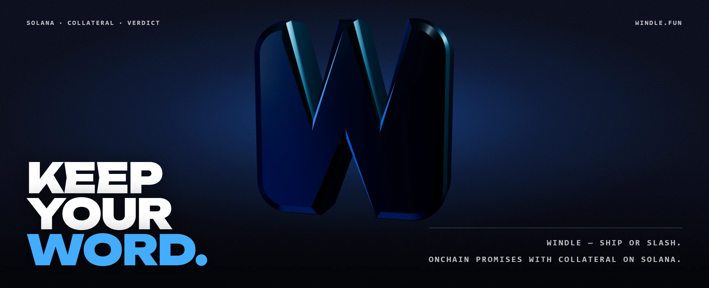
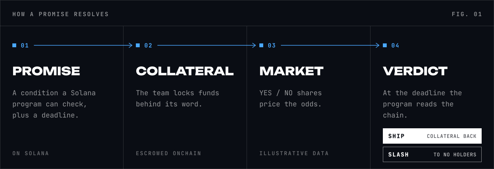
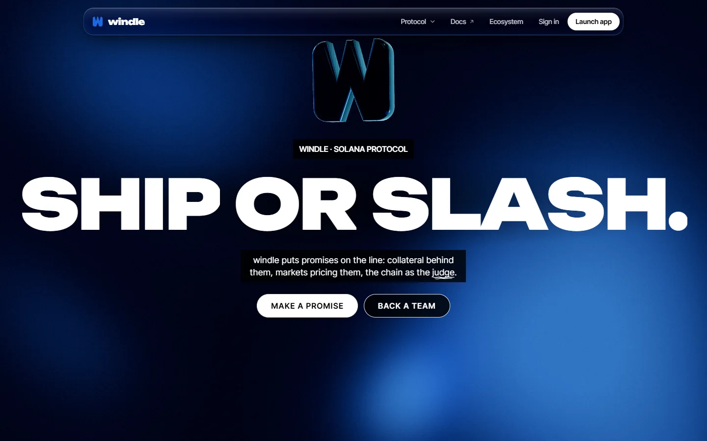
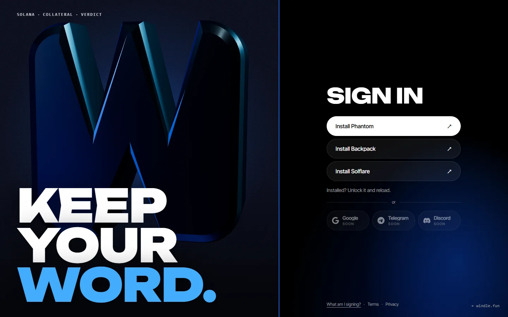
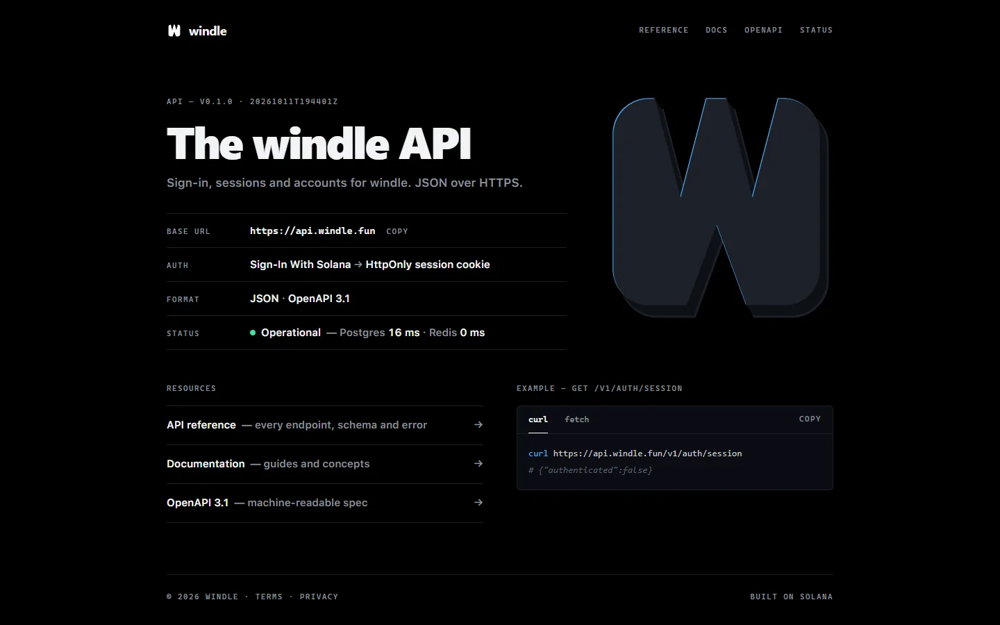

<a href="https://www.windle.fun">
  <picture>
    <source media="(prefers-color-scheme: dark)" srcset="assets/hero.webp">
    <source media="(prefers-color-scheme: light)" srcset="assets/hero.webp">
    
  </picture>
</a>

**windle** is a Solana protocol for public promises. A team states a condition a program can check, locks collateral
behind it, and a YES/NO market prices the odds. At the deadline the program reads the chain: ship, and the collateral
comes back; slash, and it goes to NO holders.

Pre-launch. Markets and prices on the site are illustrative data; no real funds are involved.

### Mechanism

<picture>
  <source media="(prefers-color-scheme: dark)" srcset="assets/mechanism-dark.svg">
  <source media="(prefers-color-scheme: light)" srcset="assets/mechanism-light.svg">
  
</picture>

### Product

<table>
<tr>
<td width="33%"></td>
<td width="33%"></td>
<td width="33%"></td>
</tr>
<tr>
<td><code>www.windle.fun</code> The protocol on one page.</td>
<td><code>oauth.windle.fun</code> Sign-In With Solana.</td>
<td><code>api.windle.fun</code> Account API, OpenAPI 3.1.</td>
</tr>
</table>

### Now building

- Sign-In With Solana — live
- Promise and market programs — in design
- Docs and API reference — live
